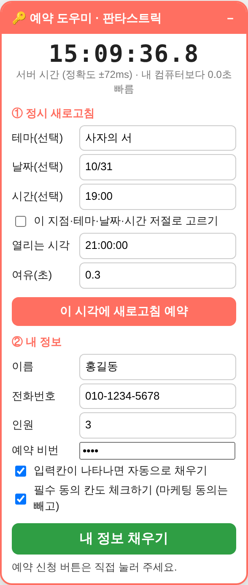

# 🔑 방탈출 예약 도우미

인기 방탈출은 예약이 열리자마자 몇 초 만에 마감돼요.
"정각에 딱 맞춰 새로고침하고, 고르고, 채우는 걸 도와주면 어떨까?" 싶어서 만든 크롬 확장 프로그램이에요.

## 무엇을 해 주나요?

1. **서버 시계** · 내 컴퓨터 시계가 아니라 예약 사이트의 시계를 0.1초 단위로 보여 줘요.
2. **정시 새로고침** · 예약이 열리는 시각에 맞춰 탭을 딱 한 번 새로고침해요.
3. **저절로 고르기** · 적어 둔 지점 → 테마 → 날짜 → 시간을 차례로 눌러요. 마감이거나 아직 안 열린 날이면 멈추고 알려 줘요.
4. **내 정보 채우기** · 이름, 전화번호, 인원, 예약 비밀번호, 필수 동의를 채워요. 마케팅 동의는 건드리지 않아요.

"로봇이 아닙니다", 그림 글자(자동등록방지), 예약 버튼은 **사람이 직접** 눌러요.

## 쓸 수 있는 사이트

| 사이트 | 해 주는 것 |
|:---|:---|
| 키이스케이프 | 지점 → 테마 → 날짜 → 시간 → NEXT → 내 정보 · 필수 동의 |
| 판타스트릭 | 테마 → 날짜 → 시간 → 내 정보 · 예약 비밀번호 · 필수 동의 |
| 제로월드 | 지점 → 테마 → 날짜 → 시간 (이름·전화번호는 직접 입력, 커서만 놓아 줘요) |
| 비트포비아 던전 | 지점 · 날짜 → 그 테마의 시간 → 내 정보 · 필수 동의 |
| doloescape · thefrank | 테마 → 날짜 → 시간 → 내 정보 (제로월드와 같은 예약 화면) |
| dpsnnn | 테마 → 날짜 → 시간 → 내 정보 (일반 방식으로 찾아봐요) |

## 설치하기

1. [방탈출예약도우미.zip](방탈출예약도우미.zip)을 내려받아 풀고, `extension` 폴더를 지우지 않을 곳에 둬요.
2. 크롬 주소창에 `chrome://extensions` → 오른쪽 위 **개발자 모드** 켜기
3. **압축해제된 확장 프로그램을 로드합니다** → `extension` 폴더 고르기
4. 예약 화면을 열면 오른쪽 아래에 도우미 창이 나타나요.

자세한 사용법은 [설치방법.txt](extension/설치방법.txt)에 있어요.

## 만들면서 알게 된 것

- 웹 서버는 응답마다 `Date` 머리글에 자기 시각을 적어 보내요. 초 단위밖에 없지만, 0.137초 간격으로 8번 물어보면 "초가 바뀌는 순간"을 좁혀서 ±100ms 안쪽까지 맞출 수 있어요.
- 사이트마다 "마감"을 보여 주는 방법이 달라요. 글자로 쓰기도 하고, 회색 동그라미(`disabled`)만 두기도 하고, `dead`, `full`, `locked` 같은 이름표만 붙이기도 해요.
- 날짜를 누르면 시간 목록을 **두 번** 그리는 사이트가 있어서, 화면이 잠깐 조용해질 때까지 기다렸다가 눌러야 했어요.
- 어떤 사이트는 이름 칸에 붙여넣기와 자동완성을 일부러 막아 둬요. 직접 치라는 뜻이라서 그런 곳은 채우지 않기로 했어요.

## 지켜요

- 내 정보는 내 컴퓨터 크롬 안에만 저장돼요. 어디로도 보내지 않아요.
- 서버 시계를 맞출 때 아주 작은 요청을 8번(정각 20초 전에 한 번 더) 보낼 뿐, 사이트에 부담을 주지 않아요.
- 본인 예약에만 써요. 대리 예약, 예약 양도·되팔기는 하지 않아요.
