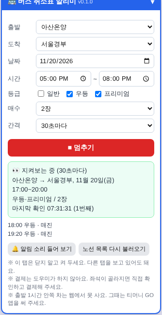

# 🚌 버스 취소표 알리미

명절이나 주말 고속버스는 금방 매진돼요. 그래도 누군가 취소하면 자리가 하나둘 다시 풀려요.
"그 순간을 대신 지켜보다가 알려 주면 어떨까?" 싶어서 만든 크롬 확장 프로그램이에요.

### [⬇️ 바로 내려받기 (v0.1.0)](https://github.com/berryst41/toy-store/raw/main/%EB%B2%84%EC%8A%A4-%EC%B7%A8%EC%86%8C%ED%91%9C-%EC%95%8C%EB%A6%AC%EB%AF%B8/%EB%B2%84%EC%8A%A4%EC%B7%A8%EC%86%8C%ED%91%9C%EC%95%8C%EB%A6%AC%EB%AF%B8.zip)

지금 버전: **v0.2.0** (2026-11-06) · 바뀐 점은 [아래 버전 기록](#버전-기록)에 있어요.

## 무엇을 해 주나요?

1. **조건 고르기** · 출발·도착 터미널, 날짜, 시간(시간대 또는 정확한 시간), 등급(일반·우등·프리미엄), 매수(1~6장)를 골라요.
2. **빈자리 지켜보기** · 정해 둔 간격(30초~5분, 1분 추천)마다 배차 조회를 한 번씩 해서 남은 자리를 확인해요.
3. **소리·알림** · 고른 조건에 맞는 자리가 나면 "띵동" 소리를 내고 윈도우 알림을 띄워요.
4. **좌석 고르기까지** · 그 차를 눌러 좌석 화면을 열고, 일반 인원 수를 맞춘 뒤 원하는 좌석(미리 적어 둔 번호, 또는 되도록 나란한 자리)을 골라 둬요.

결제 단추는 **사람이 직접** 눌러요. 그 사이 자리가 다시 차 버리면 알아서 다시 지켜보기를 시작해요.

### 이번에 새로 생긴 것 (v0.2.0)

- **시간 모드**: "시간대"(몇 시~몇 시 사이)뿐 아니라 "정확히"(딱 이 시간)도 고를 수 있어요.
- **선호 좌석**: 원하는 좌석 번호를 적어 두면(예: `12,13`) 그 번호가 비어 있을 때 그 자리를 그대로 골라요. 없으면 대신 다른 자리를 고르고 알려 드려요.
- **연석(2명)**: 매수를 2장으로 고르면 "꼭 연석으로" 체크박스가 나타나요. 켜 두면 나란히 붙은 두 자리가 없을 때는 자동으로 고르지 않고 화면만 열어 둬요.

## 쓸 수 있는 사이트

| 사이트 | 해 주는 것 |
|:---|:---|
| 고속버스통합예매 (kobus.co.kr) | 빈자리 확인 → 소리·알림 → 그 차 누르기 → 인원 · 좌석 고르기 |

- 티머니 GO 앱과 같은 예매 시스템이라, 앱에서 매진인 차도 여기서 똑같이 지켜볼 수 있어요.
- 휴대폰 앱 안에서는 돌지 않아요. 컴퓨터 크롬에서 써요.
- 출발 1시간 안쪽 차는 웹에서 예매가 안 돼서 앱으로 직접 확인해야 해요.
- 시외버스는 아직 안 돼요.

## 설치하기

1. [**⬇️ 버스취소표알리미.zip (v0.1.0) 받기**](https://github.com/berryst41/toy-store/raw/main/%EB%B2%84%EC%8A%A4-%EC%B7%A8%EC%86%8C%ED%91%9C-%EC%95%8C%EB%A6%AC%EB%AF%B8/%EB%B2%84%EC%8A%A4%EC%B7%A8%EC%86%8C%ED%91%9C%EC%95%8C%EB%A6%AC%EB%AF%B8.zip)를 눌러 내려받아 풀고, `extension` 폴더를 지우지 않을 곳에 둬요.
2. 크롬 주소창에 `chrome://extensions` → 오른쪽 위 **개발자 모드** 켜기
3. **압축해제된 확장 프로그램을 로드합니다** → `extension` 폴더 고르기
4. kobus.co.kr 을 열면 오른쪽 아래에 파란 도우미 창이 나타나요.

자세한 사용법은 [설치방법.txt](extension/설치방법.txt)에 있어요.

## 만들면서 알게 된 것

- 고속버스 배차 조회는 `/mrs/alcnSrch.do` 화면 하나로 끝나요. 차마다 출발 시각, 등급, "남은 자리 ○석"이 적혀 있어서 이것만 읽으면 돼요.
- 살 수 있는 차에는 `fnSatsChc(...)`라는 누르기 이름표가 붙고, 매진이거나 출발이 임박한 차에는 이 이름표가 아예 없어요.
- 크롬은 보이지 않는 탭의 타이머를 늦춰요. 그래서 시간 재기는 확장 프로그램의 알람(`chrome.alarms`)에 맡겼어요.
- 소리는 화면이 아니라 확장 프로그램의 보이지 않는 작은 창(offscreen)에서 내요. 그래야 다른 탭을 보고 있어도 소리가 나요.
- v0.2.0부터는 실제 kobus.co.kr 화면에서 직접 시험했어요. 노선 목록·배차 조회·좌석 화면의 실제 구조가 가정과 맞는지 하나하나 확인했어요.
- **중요** · 그 차를 누르면 kobus 사이트가 "출발일자가 맞습니까?" 같은 브라우저 자체 확인창(팝업)을 띄워요. 이 창은 확장 프로그램이 대신 눌러 줄 수 없는 창이라(브라우저 보안상 막혀 있어요), 빈자리를 찾았다는 알림이 뜨면 **그 확인창의 [확인]을 직접 눌러 주셔야** 좌석 화면으로 넘어가요. (일부 노선은 이 창 전에 안내창이 하나 더 뜰 수 있어요.) 3분 안에 눌러야 이어서 좌석을 골라 드려요.
- kobus 사이트는 인원 수를 먼저 다 늘린 뒤에 좌석을 고르는 게 아니라, **좌석을 한 자리 고른 사람 수만큼만 다음 인원을 늘릴 수 있어요** (1명 늘리기 → 그 사람 좌석 고르기 → 2명째 늘리기 → 좌석 고르기 …). 도우미도 이 순서에 맞춰 한 명씩 늘리면서 좌석을 골라요.

## 버전 기록

내가 쓰는 버전은 `chrome://extensions`의 도우미 카드에서 볼 수 있어요. 새 버전을 받으면 `extension` 폴더에 덮어쓰고 카드의 새로고침(↻)을 누른 뒤, 열려 있던 kobus 탭도 F5로 새로고침해요.

| 버전 | 날짜 | 바뀐 점 |
|:---:|:---:|:---|
| v0.2.0 | 2026-11-06 | 실제 kobus.co.kr 화면에서 시험하며 발견한 좌석 고르기 순서 문제를 고침(인원 늘리기-좌석 고르기를 한 명씩 번갈아 하도록). 정확한 시간 고르기, 선호 좌석 번호, 2명일 때 연석 필수 옵션 추가. |
| v0.1.0 | 2026-11-05 | 진열장에 처음 올림. 노선·날짜·시간대·등급·매수 고르기, 빈자리 알림(소리·윈도우 알림), 좌석 고르기까지 도와주기. |

## 지켜요

- 사이트에 부담을 주지 않게 30초보다 자주 확인하지 않아요. 한 번 확인할 때 요청은 하나뿐이에요.
- 결제는 하지 않아요. 고른 좌석을 보고 사람이 직접 결제해요.
- 본인이 탈 표에만 써요. 대리 예매, 표 되팔기는 하지 않아요.
